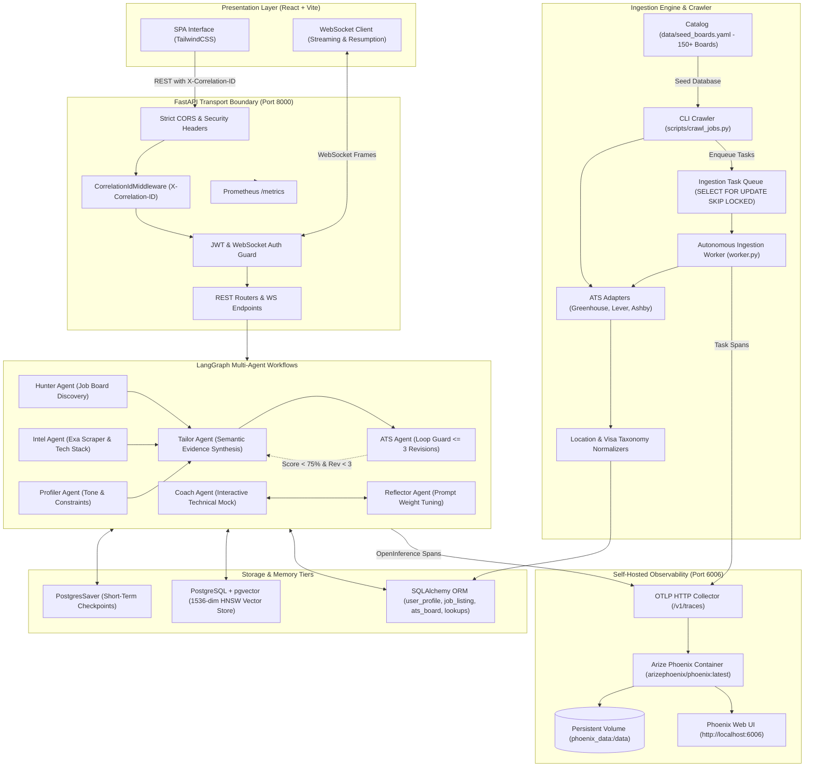
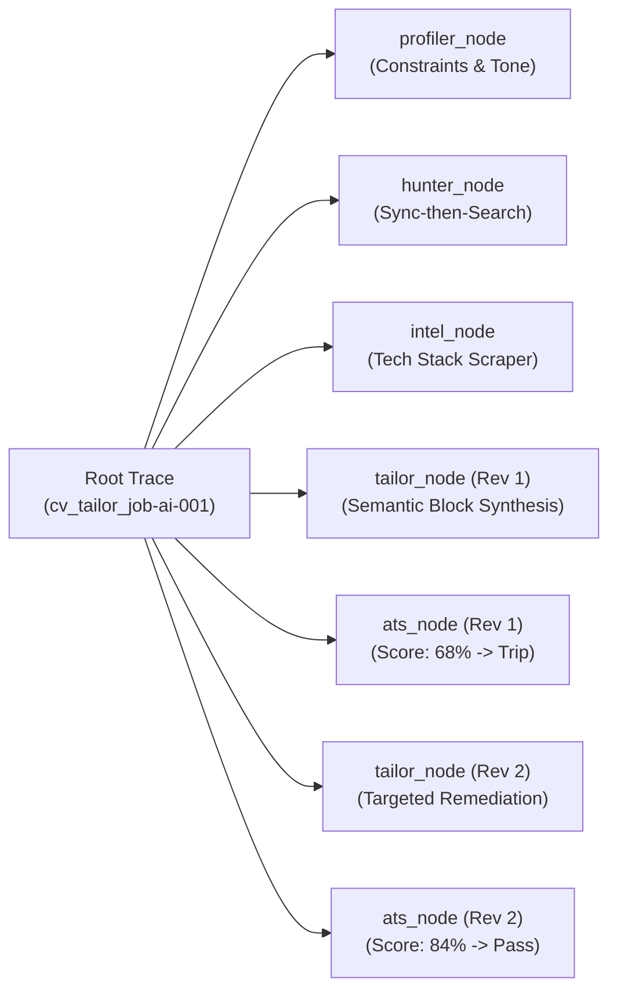

# Career-OS

Stateful AI multi-agent operating system designed to automate and optimize the end-to-end tech career lifecycle: job discovery, company intelligence extraction, evidence-grounded CV tailoring with cyclic ATS optimization, and resumable technical interview coaching.

---

## Architecture Overview

Career-OS follows a decoupled architecture: the React frontend serves strictly as a presentation layer, while all multi-agent orchestration, LLM inference, state persistence, and self-hosted observability reside within the FastAPI backend and containerized microservices.



---

## Persistence & Observability Tiers

| Tier | Technology | Purpose |
|------|------------|---------|
| **Model & Agent Observability** | **Arize Phoenix** (Self-Hosted OTLP) | Full execution trace visualization, nested agent flame graphs, token accounting, latency profiling, and PII-free prompt debugging. |
| **Operational Telemetry** | **Prometheus Metrics** (`/metrics`) | Real-time monitoring of HTTP request rates, agent execution latencies, database connection pool saturation, and ATS loop exhaustion trips. |
| **Short-Term Checkpoints** | `langgraph.checkpoint.postgres.AsyncPostgresSaver` | Pausable, resumable multi-turn WebSocket mock interviews keyed on `thread_id` across reconnections and server restarts. |
| **Semantic Vector Store** | PostgreSQL + `pgvector` with HNSW Index | 1536-dimensional cosine similarity matching of candidate career blocks (`cv_block`) against job requirements. |
| **Relational Storage** | PostgreSQL + SQLAlchemy 2.0 Async | Long-term entities: `user_profile`, `job_listing`, `company_dossier`, `cv_block`, `feedback_log`, `job_application`. |

---

## Quickstart: Starting and Running the App

### 1. Prerequisites
- **Docker & Docker Compose** (recommended for production-like deployment)
- *Or* **Python 3.12+** and **Node.js 20+** with PostgreSQL 16 (`pgvector`) for local bare-metal development.

### 2. Configuration (`.env`)
The project uses a **single centralized `.env` file** at the root of the repository for both backend and frontend configuration:

```bash
# Clone the repository
git clone https://github.com/your-username/career-os.git
cd career-os

# Initialize the centralized environment file
make .env
```

Review `.env` and configure any external API keys (optional — the platform includes full hermetic offline fallbacks for all external integrations).

---

### Mode A: Full-Stack Docker Compose (Recommended)

Starts all 5 containerized services with health checks and persistent storage:

```bash
# Build and start all services in the background
make docker-up
```

#### Services & Port Mapping

| Service | Port | Description | URL |
|---|---|---|---|
| **React Frontend** | `3000` | Web Dashboard & Interactive Chat UI | [http://localhost:3000](http://localhost:3000) |
| **FastAPI Backend** | `8000` | REST API & WebSocket Server | [http://localhost:8000](http://localhost:8000) |
| **API Documentation** | `8000` | Interactive OpenAPI / Swagger UI | [http://localhost:8000/docs](http://localhost:8000/docs) |
| **Arize Phoenix** | `6006` | Multi-Agent & LLM Observability UI | [http://localhost:6006](http://localhost:6006) |
| **Prometheus Metrics**| `8000` | Application & Connection Pool Metrics | [http://localhost:8000/metrics](http://localhost:8000/metrics) |
| **Health Probe** | `8000` | Service & Live Database Liveness Probe | [http://localhost:8000/health](http://localhost:8000/health) |
| **PostgreSQL** | `5432` | Relational Storage + pgvector Engine | `localhost:5432` |
| **OTLP Collector** | `4317` / `4318` | OpenTelemetry gRPC / HTTP Receivers | `localhost:4318/v1/traces` |

#### Viewing Logs & Stopping Services
```bash
# Stream backend application logs
docker compose logs -f backend

# Stream Arize Phoenix observability collector logs
docker compose logs -f phoenix

# Stream ingestion worker logs
docker compose logs -f worker

# Stop the stack
make docker-down
```

---

### Mode B: Hybrid Local Development (Hot Reload + Containerized Infra)

For rapid development with instant hot reloading of backend and frontend code:

```bash
# 1. Start only Postgres (with pgvector) and Phoenix containers
make docker-infra

# 2. Set up Python venv and NPM dependencies (first time only)
python3.12 -m venv .venv
./.venv/bin/pip install -r backend/requirements.txt
cd frontend && npm install && cd ..

# 3. Apply database migrations
make db-migrate

# 4. In separate terminal windows, start the app components:
make run-backend    # Starts FastAPI on http://localhost:8000 with --reload
make run-worker     # Starts background queue ingestion daemon
make run-frontend   # Starts Vite React dev server on http://localhost:5173
```

---

## Database Migrations, Tracing & Profiling

### 1. Running Database Migrations (Alembic)
Career-OS manages relational and vector schema versions using Alembic:

```bash
# Apply all pending migrations to the database
make db-migrate

# View current database revision
cd backend && ../.venv/bin/alembic current

# View complete migration history
cd backend && ../.venv/bin/alembic history --verbose
```

### 2. Tracing SQL Queries (`APP_DEBUG`)
To inspect every SQL query, parameter binding, and transaction boundary in real time:

1. In your `.env` file, set:
   ```ini
   APP_DEBUG=true
   ```
2. Restart the backend or observe stdout:
   ```text
   INFO:sqlalchemy.engine.Engine:BEGIN (implicit)
   INFO:sqlalchemy.engine.Engine:SELECT cv_block.id, cv_block.block_type FROM cv_block WHERE ...
   INFO:sqlalchemy.engine.Engine:[generated in 0.00042s] (...)
   INFO:sqlalchemy.engine.Engine:COMMIT
   ```
> [!WARNING]
> Keep `APP_DEBUG=false` in production environments to avoid leaking query structure or sensitive data into centralized logging streams.

### 3. Monitoring Connection Pool Telemetry
Live SQLAlchemy connection pool metrics are exposed directly at `GET /metrics`:

```bash
curl -s http://localhost:8000/metrics | grep career_os_db_pool
```
Output:
```text
career_os_db_pool_size 10
career_os_db_pool_checked_in 10
career_os_db_pool_checked_out 0
career_os_db_pool_overflow 0
```
- `career_os_db_pool_size`: Baseline long-lived pooled connections.
- `career_os_db_pool_checked_out`: Connections currently leased by active requests.
- `career_os_db_pool_overflow`: Short-lived burst connections (ceiling of 20).

Health probe connectivity check:
```bash
curl -s http://localhost:8000/health
```
```json
{"status":"ok","app":"Career-OS","environment":"development","database":"healthy"}
```

### 4. Direct Schema & `pgvector` Profiling
Open an interactive PostgreSQL shell in the container:

```bash
make db-shell
```

Inside `psql`:

```sql
-- 1. Verify pgvector extension and cv_block schema
\d cv_block

-- 2. Inspect 1536-dimensional HNSW cosine index
SELECT indexname, indexdef FROM pg_indexes WHERE tablename = 'cv_block';

-- 3. Profile semantic vector search performance with EXPLAIN ANALYZE
EXPLAIN ANALYZE
SELECT id, block_type, text_preview, 1 - (embedding <=> '[0.01, 0.02, ...]'::vector) AS similarity
FROM cv_block
ORDER BY embedding <=> '[0.01, 0.02, ...]'::vector
LIMIT 5;

-- 4. Inspect active LangGraph short-term interview checkpoints
SELECT thread_id, checkpoint_ns, checkpoint_id FROM checkpoints ORDER BY checkpoint_id DESC LIMIT 5;

-- 5. Inspect pending or active ingestion tasks
SELECT id, task_type, status, attempts, error_message FROM ingestion_task ORDER BY created_at DESC LIMIT 10;
```

### 5. Automated Database Backups
A secure backup script dumps relational tables and `pgvector` schemas into timestamped SQL archives:

```bash
make backup-db
```
Dumps are created under `backups/career_os_backup_<YYYYMMDD_HHMMSS>.sql`.

---

## Admin Observability: Arize Phoenix & Prometheus

Career-OS provides enterprise-grade observability combining **Arize Phoenix** (for deep LLM and agent trace inspection) with **Prometheus** (for operational metrics and alerting).

### 1. Arize Phoenix UI ([http://localhost:6006](http://localhost:6006))

Open your browser to [http://localhost:6006](http://localhost:6006) to explore execution traces.



#### What Admins Can See in Phoenix:
- **Trace Waterfall & Flame Graphs:** Every invocation of `pipeline_app`, `interview_app`, and `reflector_app` renders as an interactive tree of spans.
- **Node-by-Node Execution:** Latency and token consumption broken down by individual agent node (`profiler`, `hunter`, `intel`, `tailor`, `ats`, `coach`).
- **Prompt & Completion Inspection:** Exact prompt templates, system instructions, and raw model completions for debugging hallucination or tone drift.
- **Cyclic Loop Tracing:** The ATS revision loop is clearly visualized, showing candidate keyword gaps identified in revision 1 and how they were resolved in revision 2.

#### Zero-PII Leakage Security Model
Prompts remain completely inspectable for debugging while guaranteeing candidate privacy:
1. **In-Flight Regex Redaction:** `PIIScrubbingSpanProcessor` intercepts all prompt inputs, outputs, and message attributes before OTLP export, replacing emails (`[EMAIL_REDACTED]`), phone numbers (`[PHONE_REDACTED]`), and street addresses (`[ADDRESS_REDACTED]`). Technical skills, architecture blocks, and role titles remain unmasked.
2. **Cryptographic `subject_id` Pseudonymization:** Database UUIDs, candidate names, and emails are never exported to Phoenix spans. Instead, `user_id` is transformed via HMAC-SHA256 into a deterministic, irreversible identifier (`subj_<hex[:16]>`). Admins can correlate a candidate's sessions across time without learning their identity.

#### Filtering and Searching Traces:
- Filter by `session.id` / `thread_id`: e.g. `cv_gen_*`, `interview_*`.
- Filter by `subject_id`: correlate traces across all sessions for a specific candidate.
- Filter by `job_id`: view all tailoring runs targeted at a specific job requisition.
- Filter by `status`: isolate errors (`StatusCode.ERROR`).

---

### 2. Prometheus Metrics Catalog ([http://localhost:8000/metrics](http://localhost:8000/metrics))

Standard Prometheus text-format metrics ready for scraping by Prometheus, Grafana, or Datadog:

| Metric Name | Type | Labels | Description | Alerting Guidance |
|---|---|---|---|---|
| `career_os_http_requests_total` | Counter | `method`, `endpoint`, `status` | Total incoming HTTP API requests. | Alert on elevated 5xx rates. |
| `career_os_http_request_duration_seconds` | Gauge | `method`, `endpoint`, `metric="avg"` | Moving average HTTP endpoint latency in seconds. | Alert on latency spikes > 2s. |
| `career_os_agent_runs_total` | Counter | `graph`, `status` | LangGraph agent workflow executions (`pipeline`, `interview`, `reflector`). | Alert if `status="error"` exceeds 1%. |
| `career_os_agent_run_duration_seconds_avg` | Gauge | `graph` | Average agent graph execution duration. | Monitor model degradation. |
| `career_os_ats_loop_exhausted_total` | Counter | None | Increments whenever an ATS evaluation loop reaches `MAX_REVISIONS` (3) without achieving 75%. | **Critical:** Alert indicates candidate blocks cannot satisfy job requirements. |
| `career_os_db_pool_size` | Gauge | None | SQLAlchemy connection pool capacity ceiling. | Monitor saturation. |
| `career_os_db_pool_checked_in` | Gauge | None | Idle connections available in pool. | - |
| `career_os_db_pool_checked_out` | Gauge | None | Connections currently leased by active operations. | Alert if checked_out approaches pool_size. |
| `career_os_db_pool_overflow` | Gauge | None | Temporary burst connections allocated above pool_size. | Alert if overflow stays > 0. |

---

### 3. Distributed Correlation ID & Log Tracing

Career-OS propagates a unique `X-Correlation-ID` across the entire request lifecycle:

1. **HTTP Ingestion:** `CorrelationIdMiddleware` extracts incoming `X-Correlation-ID` (or generates a fresh UUID).
2. **Context Binding:** Bound to `correlation_id_ctx` (Python `ContextVar`).
3. **Structured JSON Logs:** Every log line emitted by the backend formats as a single-line JSON payload tagged with `"correlation_id"`:
   ```json
   {"timestamp":"2026-10-11 18:30:00","level":"INFO","logger":"career_os.http","message":"POST /api/cv/generate status=200 duration_ms=482.1","correlation_id":"demo-trace-101"}
   ```
4. **WebSocket Sessions:** WebSocket handshakes in `interview.py` establish correlation IDs at connection accept.
5. **Worker Daemon:** Queue tasks dequeued by `worker.py` bind `task.id` as active correlation ID.
6. **Phoenix & OpenTelemetry:** Automatically attached as span metadata (`metadata.correlation_id`), allowing instant cross-referencing between HTTP logs and Phoenix traces.

---

## 2-Minute Hands-On Verification Walkthrough

Verify the entire observability pipeline with a single command:

### Step 1: Submit a Tailoring Request with Custom Correlation ID
```bash
curl -X POST http://localhost:8000/api/cv/generate \
  -H "Content-Type: application/json" \
  -H "X-Correlation-ID: audit-run-909" \
  -d '{
    "job_id": "job-ai-001",
    "user_id": "candidate-alex-smith",
    "title": "Senior AI Systems Engineer",
    "company_name": "NexusAI Labs",
    "required_skills": ["Python", "FastAPI", "pgvector", "LangGraph"]
  }'
```

### Step 2: Observe Phoenix Observability ([http://localhost:6006](http://localhost:6006))
1. Open [http://localhost:6006](http://localhost:6006) and select the `career-os` project.
2. In the search bar, filter by `audit-run-909`.
3. Open the trace:
   - Notice `user.id` is pseudonymous (e.g., `subj_4f2a89c1...`).
   - Notice the trace displays the full execution tree: `profiler -> hunter -> intel -> tailor -> ats`.
   - Click into any span to view sanitized prompt inputs and model response tokens.

### Step 3: Verify Prometheus Metrics ([http://localhost:8000/metrics](http://localhost:8000/metrics))
```bash
curl -s http://localhost:8000/metrics | grep -E "career_os_agent_runs_total|career_os_http_requests_total"
```
Observe that `career_os_agent_runs_total{graph="pipeline",status="success"}` has incremented.

---

## Scaled Ingestion Engine & CLI Crawler

Career-OS indexes public ATS job boards (Greenhouse, Lever, Ashby) without metered rate limits or API keys. The system uses a declarative seed catalog (`data/seed_boards.yaml`) containing 150+ verified employers across high-growth sectors (`hft_quant_trading`, `fintech`, `ai_ml_infra`, `biotech`, `devtools`, `cybersecurity`) and global hubs (US, Canada, UK, Europe, Australia, New Zealand).

All crawled jobs pass through:
1. **`LocationNormalizer`**: Extracts granular coordinates (`city`, `state_province`, `country_code`, `primary_region`), separating physical modality (`on_site`, `hybrid`, `remote`) from legal jurisdiction scope (`worldwide_global`, `country_wide`, `state_province`, `none`).
2. **`VisaSponsorshipParser`**: Classifies multi-jurisdiction visa policies (US H-1B/OPT, UK Skilled Worker, Canada LMIA, Australia Subclass 482, EU Blue Card), storing `NULL` when unmentioned.
3. **Database Constraints**: Clean foreign-key referential integrity (`ats_provider`, `industry_sector`, `ats_board`) with deduplication keyed on `(ats_provider, ats_slug, provider_job_id)`.

### Crawler CLI Usage (`scripts/crawl_jobs.py`)

```bash
# 1. Seed the database with the verified 150+ board catalog
PYTHONPATH=backend python scripts/crawl_jobs.py --seed-db

# 2. View ingestion telemetry across sectors, countries, modalities, and visa policies
PYTHONPATH=backend python scripts/crawl_jobs.py --stats

# 3. Target specific sectors (e.g. HFT & Quant Trading)
PYTHONPATH=backend python scripts/crawl_jobs.py --industry hft_quant_trading

# 4. Target specific countries or regions
PYTHONPATH=backend python scripts/crawl_jobs.py --country Canada
PYTHONPATH=backend python scripts/crawl_jobs.py --region europe --limit 10

# 5. Targeted single-board crawl
PYTHONPATH=backend python scripts/crawl_jobs.py --board greenhouse:stripe

# 6. Autonomous due-board crawl (or full crawl)
PYTHONPATH=backend python scripts/crawl_jobs.py --due
PYTHONPATH=backend python scripts/crawl_jobs.py --all --limit 50
```

---

## Autonomous Ingestion Worker & Queue Monitoring

The background ingestion worker (`python -m app.ingestion.worker`) polls the `ingestion_task` table using `SELECT FOR UPDATE SKIP LOCKED` for lock-free parallel scaling:

### 1. Task Queue Lifecycle
- `pending`: Waiting in queue for an available worker thread.
- `processing`: Locked by an active worker.
- `completed`: Successfully processed; job listings ingested and embedded.
- `failed`: Tripped an exception; inspect `error_message` for details.

### 2. Inspecting Budget Ledgers & Circuit Breakers
To inspect quota usage and upstream circuit breaker health:

```bash
make db-shell
```
```sql
-- Check daily request usage against external job APIs
SELECT provider, call_count, max_budget_per_day, last_reset_at FROM ingestion_budget_ledger;

-- Check circuit breaker status for ATS providers
SELECT provider, status, failure_count, last_failure_at FROM ingestion_circuit_breaker;
```

---

## Operations, Troubleshooting & Common Pitfalls

### 1. Port 6006 Already in Use
If port `6006` is already occupied by TensorBoard or another tool:
1. In `docker-compose.yml`, change the host port mapping:
   ```yaml
   ports:
     - "6007:6006"
   ```
2. Update `PHOENIX_PORT=6007` and `PHOENIX_COLLECTOR_ENDPOINT=http://localhost:6007/v1/traces` in `.env`.

### 2. Traces Not Appearing in Phoenix
- **Docker Compose:** Ensure the containerized backend connects to `http://phoenix:6006/v1/traces` (service name on Docker network bridge), NOT `localhost`.
- **Bare-Metal Local:** Ensure local backend connects to `http://localhost:6006/v1/traces`.
- **Check Telemetry Status:** Verify `PHOENIX_ENABLED=true` in `.env`. Tracing is automatically disabled when `APP_ENV=test` or under `pytest`.

### 3. Database Cold-Start Notice
On a fresh container boot, you may see:
```text
WARNING: Vector extension bootstrap deferred during startup: ...
```
This is an intentional non-fatal guard: if the PostgreSQL container is completing startup initialization, FastAPI defers the extension check and retries on first query, preventing container crash loops.

### 4. Clearing or Backing Up Phoenix Trace History
Phoenix stores DuckDB/SQLite trace data inside the named volume `phoenix_data:/data`:
```bash
# Wipe all stored trace history
docker compose down -v

# Or delete only the Phoenix data volume
docker volume rm career-os_phoenix_data
```

### 5. Running Tests Hermetically
All test suites enforce zero external network calls:
```bash
make test
```
The test configuration automatically detects pytest and forces `PHOENIX_ENABLED=false`, guaranteeing all 176+ tests execute 100% offline without attempting OTLP network calls.

---

## Environment Variables Reference

| Variable | Default | Description |
|---|---|---|
| `APP_ENV` | `development` | Runtime environment (`development`, `test`, `production`). |
| `APP_DEBUG` | `false` | Echoes raw SQL statements to stdout (disable in production). |
| `DATABASE_URL` | Derived | PostgreSQL connection string (`postgresql+psycopg://...`). |
| `SECRET_KEY` | Dev default | Cryptographic key for signing JWTs and deriving pseudonymous `subject_id`. |
| `CORS_ORIGINS` | `["http://localhost:5173", ...]` | Whitelisted frontend origins. |
| `CORS_EXPOSE_HEADERS` | `["X-Correlation-ID"]` | Headers exposed to browser clients for distributed tracing. |
| `PHOENIX_ENABLED` | `true` | Enables OpenTelemetry / Arize Phoenix multi-agent tracing. |
| `PHOENIX_COLLECTOR_ENDPOINT` | `http://localhost:6006/v1/traces` | OTLP HTTP trace collector endpoint. |
| `PHOENIX_PROJECT_NAME` | `career-os` | Phoenix project namespace for grouping traces. |
| `PHOENIX_SAMPLING_RATE` | `1.0` | Telemetry sampling ratio (0.0 to 1.0). |
| `PHOENIX_ANONYMIZE_PII` | `true` | Scrubs candidate emails, phone numbers, and street addresses from spans. |
| `ATS_PASS_THRESHOLD` | `75.0` | Minimum score percentage required to pass ATS evaluation. |
| `MAX_REVISIONS` | `3` | Maximum cyclic revisions between Tailor and ATS agents before loop guard trips. |
| `GEMINI_API_KEY` | `None` | Google Gemini API key. If unset, uses hermetic `MockChatModel`. |
| `JSEARCH_API_KEY` | `None` | Optional fallback job board search key. |
| `EXA_API_KEY` | `None` | Optional Exa API key for neural company intelligence web scraping. |
| `APOLLO_API_KEY` | `None` | Reserved for commercial recruiter contact search. |
| `VITE_API_URL` | `http://localhost:8000` | REST API URL for the frontend. |
| `VITE_WS_URL` | `ws://localhost:8000` | WebSocket API URL for the frontend. |

---

## Testing & Quality Gates

Run the verification suite locally before committing:

```bash
# Format code using ruff
make format

# Static linting & Type analysis (ruff + mypy)
make lint

# Run full hermetic test suite (176+ tests, zero network dependencies)
make test

# Build frontend production assets
make build
```

---

## Architecture Decision Records (ADRs)

Detailed architectural rationale and design choices are documented in `doc/adr/`:
- [ADR-001: pgvector Schema and 1536-Dimensional Semantic Embeddings](doc/adr/ADR-001-pgvector-schema-and-embedding-dimensions.md)
- [ADR-002: Checkpointer Persistence and Thread Namespacing](doc/adr/ADR-002-checkpointer-persistence-and-thread-namespacing.md)
- [ADR-003: Agent Graph Decomposition and ATS Loop Guard](doc/adr/ADR-003-agent-graph-decomposition-and-ats-loop-guard.md)
- [ADR-004: Foreign Key Strict RESTRICT Deletion Policy](doc/adr/ADR-004-foreign-key-strict-restrict-deletion-policy.md)
- [ADR-005: LLM Provider Abstraction and Google Gemini Integration](doc/adr/ADR-005-llm-provider-abstraction-and-gemini-integration.md)

---

## License
MIT
