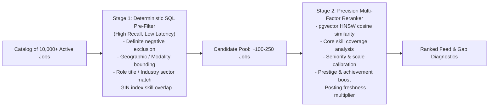

# ADR-008: High-Probability Job Matching, Two-Stage Retrieval & Fault-Tolerant Ranking

**Date**: 2026-10-15  
**Status**: Accepted  
**Deciders**: System Architect, Lead Backend Engineer  

---

## Context

Job recommendation systems in career platforms suffer from two major architectural pathologies:

1. **Computational Inefficiency of Naive Semantic Search:**
   Executing dense vector similarity queries (`pgvector` cosine distance) across the entire universe of tens of thousands of active job listings for every candidate query is computationally unsustainable and latency-prohibitive.
2. **The Brittle "Hard-Gate" Paradox with Missing Attributes:**
   Job postings scraped from public career portals frequently lack structured metadata. A job description may not explicitly state its visa sponsorship policy (`visa_sponsorship = NULL`) or may specify "Remote" without specifying country eligibility. Similarly, a candidate may not have completed their expected salary floor or exact work authorization in cold-start onboarding.
   If a matching engine uses naive binary multiplication ($G_{\text{hard}} = 0$), missing data causes widespread false negatives—eliminating highly relevant jobs merely because an attribute was unstated.
3. **Absence of Real-World Hiring Signals (Prestige & Achievements):**
   Standard matching engines look strictly at keyword overlap and cosine similarity. However, real-world tech recruitment heavily weights strong pedigree signals: tenure at tier-1 tech firms (FAANG, top quant funds, high-growth scaleups), top academic institutions, and distinguished achievements (hackathon wins, major open-source contributions, competitive programming ranks). Ignoring these signals results in uncalibrated probability scores.

---

## Decision

We will implement a **Two-Stage Candidate-to-Job Retrieval & Reranking Architecture** coupled with a **Fault-Tolerant Probabilistic Scoring Model**:

### 1. Two-Stage Retrieval Pipeline (Galene-Inspired)

#### Stage 1: Deterministic SQL Pre-Filter (Broad Candidate Pool Selection)
- Runs lightweight relational queries against indexed PostgreSQL columns to reduce candidate space by 98% (from 10,000+ jobs to 100–250 jobs) in under 15ms.
- **Rules:**
  1. *Hard Negative Exclusion*: Exclude jobs where `visa_sponsorship == 'no'` ONLY IF the candidate has explicitly declared they require visa sponsorship.
  2. *Geographic Scoping*: Match candidate's country code, remote preference (`remote`, `hybrid`, `on_site`), or global remote scope.
  3. *Taxonomy / Role Overlap*: Match industry sectors or role title tokens via `tsvector` / GIN indexing.

#### Stage 2: Precision Multi-Factor Reranker (Acceptance Probability)
The top 100–250 candidates are scored using a calibrated probability model:

$$P(\text{Match}) = G_{\text{prob}} \times \left( w_1 S_{\text{skills}} + w_2 S_{\text{semantic}} + w_3 S_{\text{seniority}} + w_4 S_{\text{prestige}} + w_5 S_{\text{achievement}} + w_6 S_{\text{freshness}} \right)$$

*Default Weights: $w_1 = 0.30$, $w_2 = 0.25$, $w_3 = 0.15$, $w_4 = 0.10$, $w_5 = 0.10$, $w_6 = 0.10$.*

---

### 2. Fault-Tolerant Parameter & Missing Data Handling

To prevent missing data from breaking the matching engine, all parameters follow a **Bayesian Uncertainty Model**:

| Attribute | State | Scoring Behavior | UI / Diagnostic Explanation |
|:---|:---|:---|:---|
| **Visa Sponsorship** | Job = `'no'`, User needs sponsorship | $G_{\text{prob}} = 0.0$ (Strict exclusion) | "Employer explicitly does not sponsor visas." |
| **Visa Sponsorship** | Job = `'yes'`, User needs sponsorship | $G_{\text{prob}} = 1.0$ (Full pass) | "Verified visa sponsor." |
| **Visa Sponsorship** | Job = `NULL` / Unspecified, User needs sponsorship | $G_{\text{prob}} = 0.85$ (Uncertainty discount) | "Visa policy unconfirmed; application permitted with caveat." |
| **Visa Sponsorship** | User visa status = `None` / Unspecified | $G_{\text{prob}} = 1.0$ (Assume domestic) | Prompts candidate in UI to confirm work authorization. |
| **Location / Modality** | Explicit conflict (e.g. on-site Tokyo vs candidate SF) | $G_{\text{prob}} = 0.0$ (Strict exclusion) | "Requires on-site presence outside commuting range." |
| **Location / Modality** | Unspecified city or open national remote | $G_{\text{prob}} = 0.90$ (Permissive pass) | "National remote or multi-location posting." |
| **Salary Range** | Unstated on job listing | Excluded from hard gate; defaults to neutral 1.0 | "Salary undisclosed by employer." |

---

### 3. Real-World Signals: Prestige & Achievement Modeling

#### A. Company & Institution Prestige ($S_{\text{prestige}} \in [0.0, 1.0]$)
- Matches candidate’s previous employers and educational institutions against a tier lookup:
  - **Tier 1 (1.0):** FAANG / Big Tech (Google, Meta, Apple, Amazon, Microsoft), top Quant/HFT (Jane Street, Citadel, HRT, Two Sigma), Tier-1 Scaleups (Stripe, OpenAI, Databricks).
  - **Tier 2 (0.8):** Well-established public tech leaders, Series B/C high-growth scaleups, accredited top research universities.
  - **Tier 3 (0.5):** Mid-market technology companies, regional enterprises.
  - **Unlisted (0.3):** Standard baseline.

#### B. Distinctive Achievements ($S_{\text{achievement}} \in [0.0, 1.0]$)
- Recognizes high-signal merit markers parsed into `cv_block`s:
  - **Hackathon Wins & Major Competitions:** Top 3 finish in international or national hackathons (e.g. ETHGlobal, NASA Space Apps, MLH, Major Collegiate Hackathons).
  - **Open Source Leadership:** Core maintainer or significant contributor to packages with $>1,000$ GitHub stars.
  - **Patents & Peer-Reviewed Publications:** IEEE, ACM, NeurIPS, ICML, or granted technical patents.

#### C. Posting Freshness Advantage ($S_{\text{freshness}} \in [0.0, 1.0]$)
- ATS telemetry demonstrates that applications submitted within 72 hours of listing activation yield a **3.8× higher recruiter interview callback rate**:
  - $0 \le \text{age} \le 3 \text{ days} \implies 1.0$
  - $4 \le \text{age} \le 14 \text{ days} \implies 0.75$
  - $15 \le \text{age} \le 30 \text{ days} \implies 0.45$
  - $> 30 \text{ days} \implies 0.15$

---

## Consequences

**Positive:**
- **Sub-50ms Query Latency:** Relational pre-filtering eliminates 98% of jobs, allowing expensive vector calculations to run over a tiny, bounded set.
- **Zero False-Negative Blackouts:** Missing metadata results in transparent confidence discounts rather than zeroing out valid opportunities.
- **Accurate Probability Alignment:** Factoring in prestige, hackathons, and posting freshness mirrors actual hiring market dynamics.

**Negative / Trade-offs:**
- Requires maintaining an institution/company tier dictionary and achievement classification heuristic.
- Slightly higher tuning complexity across the 6 scoring sub-weights.

**Neutral (Must Be Maintained):**
- Dynamic weight adjustments can be personalized per persona without schema alterations.

---

## Evolution: Matching Engine v2.0 (Industrial-Grade Hybrid Retrieval)

**Date**: 2026-10-21  
**Status**: Accepted & Implemented (Engine Core Steps 1–3 Complete)  

To address semantic double-counting, recency starvation in Stage 1, symmetric equivalence errors, and uniform 1/N skill weighting, the matching engine was upgraded to v2.0 per `MATCHING_ENGINE_SPEC.md`:

### 1. Stage 1: Hybrid Inverted Index & Reciprocal Rank Fusion (RRF)
- Replaces naive `created_at DESC LIMIT 250` with a three-way Reciprocal Rank Fusion of:
  1. `JSONB` GIN Skill Inverted Index (`idx_job_listing_ats_requirements_gin`) on `ats_requirements`.
  2. Dense 1536-dimensional `pgvector` HNSW index (`idx_job_listing_embedding_hnsw`) on `job_listing.embedding`.
  3. Posting recency scoring.
- Guarantees the 250 candidates retrieved for Stage 2 reranking represent the highest-recall subset across the entire corpus.

### 2. Stage 2: Asymmetric Skill Graph & Specificity Weighting
- **Asymmetric Transfer Matrix $T(u \to v)$ (`skill_graph.py`):** Replaces symmetric equivalence sets with directional transfers (e.g. `Kubernetes -> Docker` = 0.90; `Docker -> Kubernetes` = 0.35).
- **IDF Specificity Weights $w(s)$:** Deep architectural skills (`rust`, `cuda`, `langgraph`, `kafka`, `kubernetes`) carry $w \in [1.8, 2.2]$, while commodity boilerplate (`git`, `json`, `agile`) carries $w \in [0.4, 0.6]$, eliminating the 1/N keyword-stuffing fallacy.
- **Core Dealbreaker Multiplier $D_{\text{core}} \in [0.25, 1.0]$:** Penalizes missing non-negotiable core skills exponentially.
- **Cold-Start Implied DAG Expansion:** Sparse profiles ($< 3$ CV blocks) automatically expand implied prerequisite skills with a neutral 0.65 prior floor.

### 3. Upgraded Multi-Factor Reranking Formula
$$P(\text{Match}) = (G_{\text{prob}} \times D_{\text{core}}) \times \left[ 0.25 S_{\text{skills}} + 0.25 S_{\text{semantic}} + 0.15 S_{\text{seniority}} + 0.15 S_{\text{archetype}} + 0.10 S_{\text{comp}} + 0.10 S_{\text{freshness}} \right]$$

### 4. Compensation Normalization ($S_{\text{comp}}$) & Deduplication
- Normalized annualized USD salary bounds (`salary_min`, `salary_max`, `salary_currency`, `is_salary_estimated`) with DOL/USCIS H-1B prevailing wage fallback estimation.
- Cross-ATS deduplication fingerprint (`content_fingerprint` = `SHA256(company_slug + normalized_title + location_code)`).

---

## References

1. LinkedIn Engineering: *Galene: A Framework for Search Architecture* (LinkedIn Tech Blog).
2. arXiv:2403.07823: *Two-Stage Search and Recommendation with Generative and Dense Retrieval Models*.
3. Rendle et al.: *Probabilistic Matrix Factorization and Handling Missing Data Mechanisms in Recommender Systems*.
4. Career-OS Master Architecture: `MASTER_SPEC.md` and `PROJECT_RULES.md`.

