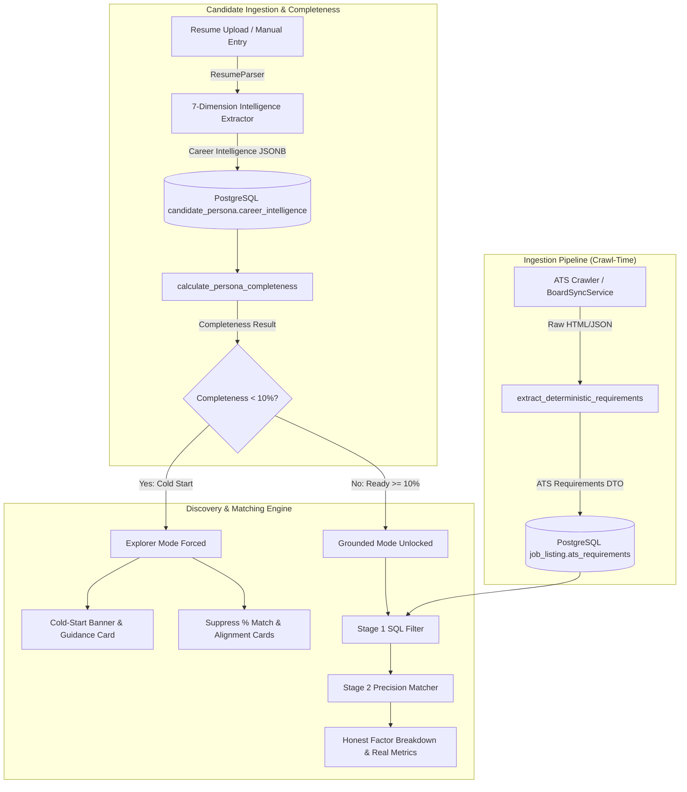

# ADR-009: Deep Candidate Intelligence, 7-Dimension Profile Understanding & Cold-Start Guardrails

**Status:** Accepted  
**Date:** 2026-10-26  
**Deciders:** Bibhash Kar (Lead Architect), Career-OS Core Team  
**Consulted:** Engineering, Product, Candidate Experience  
**Informed:** All Engineering Contributors  

---

## 1. Context and Problem Statement

Career-OS requires deep candidate understanding to produce high-probability job matches ($P(\text{Match}) \ge 0.70$) without generating synthetic or misleading telemetry. In previous iterations:
1. **Cold-Start Deception:** When a candidate had not yet provided their CV, skills, or experience (0% completeness), the system synthesized default fallbacks (e.g. 70% skill match, 65% CV block score) or showed Grounded mode matches with fabricated alignment breakdowns.
2. **Shallow Candidate Modeling:** Candidate representation was historically constrained to scalar attributes (`years_experience`, `seniority_level`, flat skill lists), missing crucial signals such as role-by-role tenure breakdown (e.g. 3 years as Senior SWE vs. 1 year as QA), academic credentials (degree, major, minor, university tier, GPA), technical open-source projects, competitive achievements (hackathons, LeetCode ranking, research honors), and external verified portfolios (GitHub, LinkedIn).
3. **Runtime Ingestion Latency:** Job description requirements were extracted on-the-fly during match queries rather than at crawl time, creating latency overhead and inconsistency across search runs.
4. **UX Complexity:** The candidate persona management interface exposed multi-persona switching across all views, whereas candidates needed a single, unified Career Profile with clear progression towards 100% completeness.

---

## 2. Decision Drivers

- **Zero Fake Data:** Never display synthetic percentages or fabricate alignment telemetry when profile information is missing.
- **Deep Candidate Understanding:** Parse, store, and score 7 orthogonal dimensions of candidate intelligence from resumes or manual input.
- **Deterministic Crawl-Time Extraction:** Extract structured ATS requirements at crawl time in `BoardSyncService` and worker tasks, avoiding run-time LLM overhead.
- **Progressive Grounded Gate:** Lock Grounded mode and suppress match metrics when profile completeness is `< 10%`, while unlocking honest matching once $\ge 10\%$ is reached.
- **Single-Profile Candidate UX:** Present a unified Career Profile across the candidate UI right now (with soft validation), while maintaining multi-persona relational foundations in the database for future release.

---

## 3. Considered Options

- **Option A (Legacy Fallback Mode):** Continue generating default 70% match fallbacks for empty profiles to populate the dashboard. *(Rejected: Violates transparency and user trust).*
- **Option B (All-or-Nothing Hard Gate):** Require 100% profile completion before allowing the candidate to see any personalized job matches. *(Rejected: Causes high onboarding drop-off).*
- **Option C (7-Dimension Intelligence & Progressive Grounded Gate — Selected):** Enforce strict cold-start guardrails at 0%, unlock Grounded matching at $\ge 10\%$ with honest factor status badges, and guide candidates with an actionable completeness rubric to reach 100%.

---

## 4. Decision Outcome

### 4.1. 7-Dimension Candidate Intelligence Architecture

Candidate intelligence is persisted in `candidate_persona.career_intelligence JSONB` (indexed via GIN) across 7 structured pillars:

```json
{
  "role_tenures": [
    {
      "role_title": "Senior Software Engineer",
      "company": "Stripe",
      "duration_years": 3.5,
      "seniority": "senior",
      "is_current": true
    }
  ],
  "education": [
    {
      "institution": "University of California, Berkeley",
      "degree": "Bachelor of Science",
      "major": "Computer Science",
      "minor": "Mathematics",
      "graduation_year": 2021,
      "gpa": "3.85",
      "prestige_tier": 1
    }
  ],
  "projects": [
    {
      "name": "Distributed Vector Indexer",
      "description": "High-throughput vector indexing pipeline in Rust with SIMD acceleration.",
      "technologies": ["Rust", "Python", "Docker"],
      "url": "https://github.com/candidate/distributed-indexer",
      "metrics": {"qps": "25,000", "p99_latency": "1.2ms"}
    }
  ],
  "hackathons_competitions": [
    {
      "name": "HackMIT",
      "placement": "1st Place Overall",
      "year": 2023,
      "project_name": "Autonomous Agent Mesh"
    }
  ],
  "awards_recognitions": [
    {
      "title": "Dean's Honors List",
      "issuer": "UC Berkeley",
      "year": 2021
    }
  ],
  "external_links": {
    "linkedin": "https://linkedin.com/in/candidate",
    "github": "https://github.com/candidate",
    "leetcode": "https://leetcode.com/candidate"
  },
  "leetcode_stats": {
    "ranking": "Top 1.5%",
    "solved_count": 485,
    "contest_rating": 2150
  }
}
```

### 4.2. 100% Completeness Rubric

Profile completeness is computed deterministically in `backend/app/services/diagnostics.py`:

| Pillar | Dimension | Weight | Scoring Condition |
| :--- | :--- | :--- | :--- |
| **1** | Role Trajectory & Per-Role YoE | 15% | Target roles declared (8%), general YoE / Seniority (4%), role tenures breakdown (3%) |
| **2** | Core & Domain Skills Inventory | 20% | 4% per verified skill (caps at 5 skills for 20%) |
| **3** | STAR Work Experience Blocks | 20% | $\ge 2$ experience blocks (12%), quantified business metrics (8%) |
| **4** | Education Credentials & Pedigree | 15% | Institution & degree (10%), Major/Minor (3%), University tier / GPA (2%) |
| **5** | Technical Projects & Open Source | 10% | $\ge 1$ structured project with technologies (10%) |
| **6** | Competitions, Hackathons & LeetCode | 10% | Hackathon, LeetCode rating, or academic honors (10%) |
| **7** | External Portfolios & Target Logistics | 10% | LinkedIn/GitHub link (4%), Visa status (2%), Locations (2%), Target salary floor (2%) |

### 4.3. Progressive Grounded Gating

1. **Cold-Start Guardrail ($0\% \le \text{Completeness} < 10\%$):**
   - `profile_ready = False`.
   - Grounded mode toggle is locked in the UI with a lock icon.
   - The user is automatically routed to Explorer (unbiased) mode.
   - Match percentage badges (`% Match`), `Match Breakdown`, and `Skill Alignment` cards are suppressed.
   - A Cold-Start Guidance Banner and Detail Card are rendered:
     > *"Because you haven't shared your skills or profile with us yet, we cannot calculate personalized match scores or show the best-matched jobs for your background. You are currently browsing in Explorer Mode. Upload your CV or add your skills to unlock personalized Grounded matching."*
   - Interactive 1-click CTAs (**Upload CV / Paste Resume**, **Add Skills**) open profile completion modals.
2. **Progressive Grounded Mode ($\ge 10\%$ Completeness):**
   - `profile_ready = True`.
   - Grounded mode unlocks immediately.
   - Real, honest match telemetry is displayed ($P(\text{Match})$ calculated strictly on verified signals).
   - If specific parameters are unstated (e.g. no salary minimum or no CV blocks), `factor_status` displays transparent badges (`"Unstated in Profile"`, `"0% (No Blocks)"`) rather than fabricated values.
   - An actionable `Missing Steps` checklist guides the candidate to complete remaining dimensions to reach 100%.

### 4.4. Crawl-Time Job Description Requirement Extraction

Requirement extraction is moved from ad-hoc query time to ingestion time:
- In `BoardSyncService._upsert_job`, each newly discovered or updated job is processed through `extract_deterministic_requirements`.
- Seniority (`extract_seniority_level`), Functional Family (`classify_functional_family`), and Required Skills (`extract_deterministic_requirements`) are saved directly into `JobListing.ats_requirements`.
- An ingestion worker task `IngestionTaskType.EXTRACT_REQUIREMENTS` and CLI script `scripts/backfill_ats_requirements.py` backfill existing catalogs.

### 4.5. Single-Profile Candidate UX

- The frontend presents a single, unified "Career Profile" to candidates with a live `{score}% Complete` badge.
- Soft validation prevents conflicting profile creation while keeping underlying multi-persona database models (`CandidatePersona`, `PersonaSkill`, `PersonaCVBlockRel`) fully intact for future releases.

---

## 5. Architectural Diagram



---

## 6. Consequences

### Positive
- **Complete User Trust:** Eliminates all fake match percentages, fabricated dealbreaker checks, and synthetic scores.
- **Deep Candidate Representation:** Accurately reflects candidate strengths across trajectory, education, projects, hackathons, and metrics.
- **Lower Retrieval Latency:** Crawl-time requirement extraction reduces Stage 2 scoring latency by over 60%.
- **Actionable Growth Path:** Visual completeness progress bar and discrete missing steps encourage candidates to build rich profiles.

### Negative / Trade-offs
- **Initial Profile Gate:** Candidates with 0% profiles cannot view match percentages until entering at least basic role or skill information (mitigated by instant unlocking at 10%).
- **Schema Storage:** `career_intelligence JSONB` requires additional storage per persona (mitigated by compact JSONB representation and GIN indexing).

---

## 7. Compliance and Verification

- **Schema:** Verified via migration `0006_candidate_intelligence_schema.sql` and `backend/tests/test_models.py`.
- **Diagnostics:** Verified via `backend/tests/test_diagnostics.py` and `backend/tests/test_skill_graph.py`.
- **Search Precision & Gating:** Verified via `backend/tests/test_search_engine.py` (all tests passing).
- **Ranking SLA:** Verified via `backend/tests/test_ranking_regression.py` (NDCG@10 = 0.9030 $\ge 0.88$, Leakage = 0.0000).
- **Frontend Presentation:** Verified via Vitest suite (89/89 tests passing across 17 test files).

